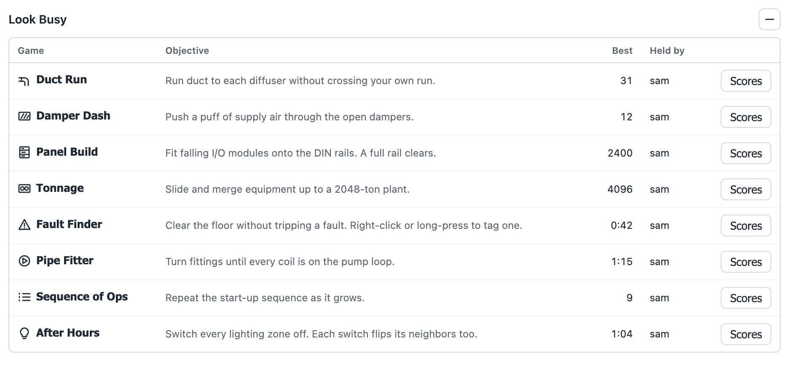
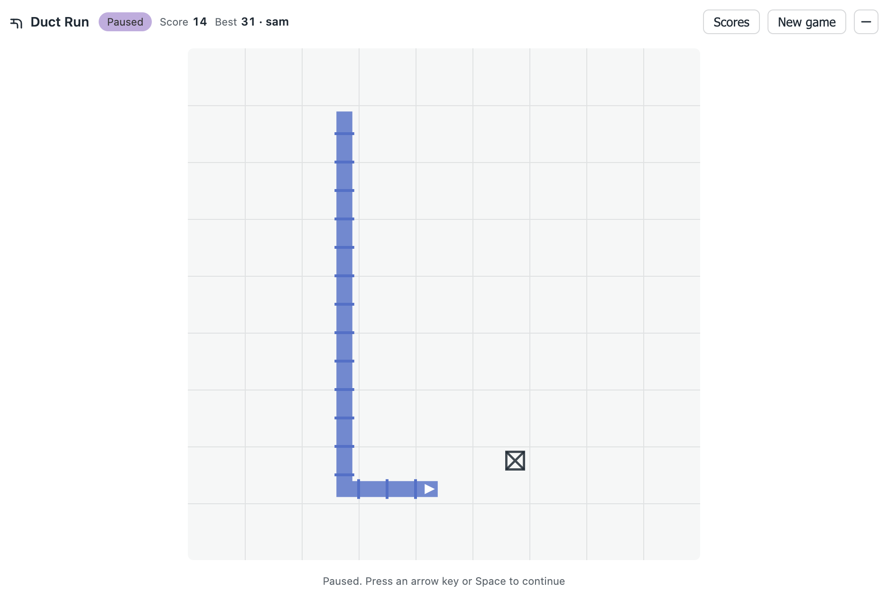
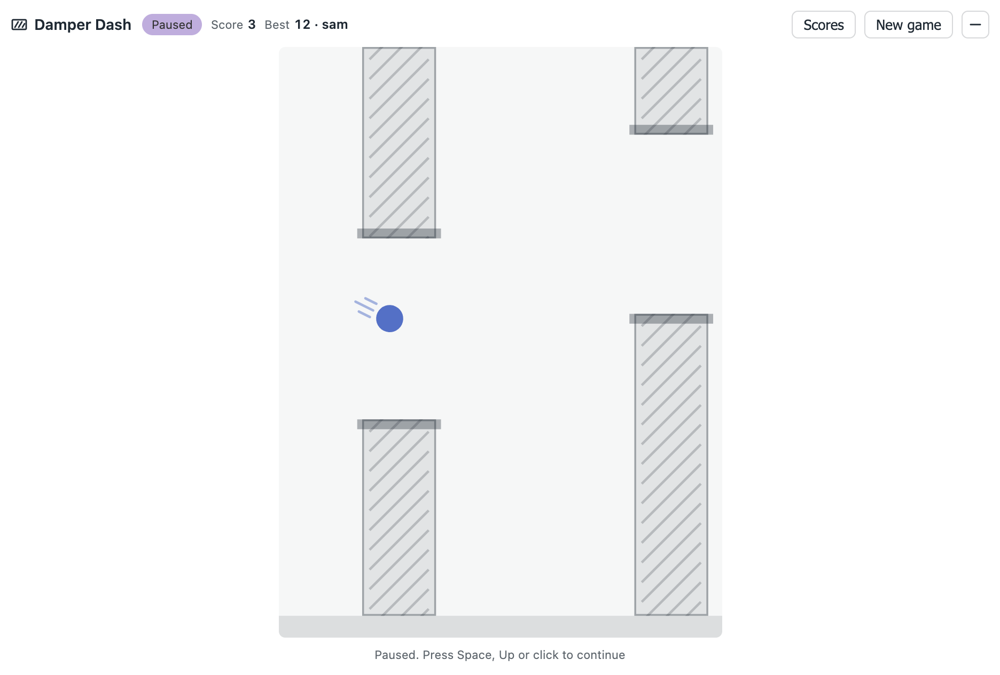
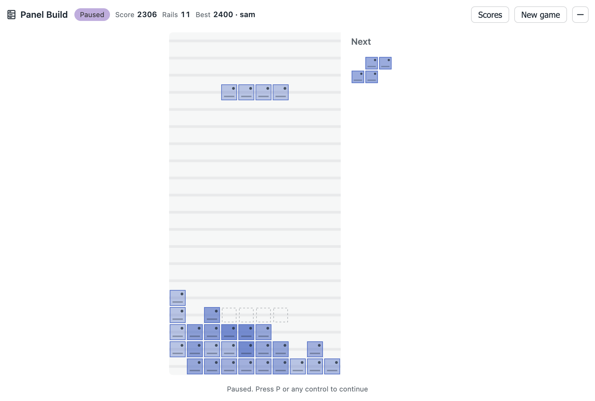
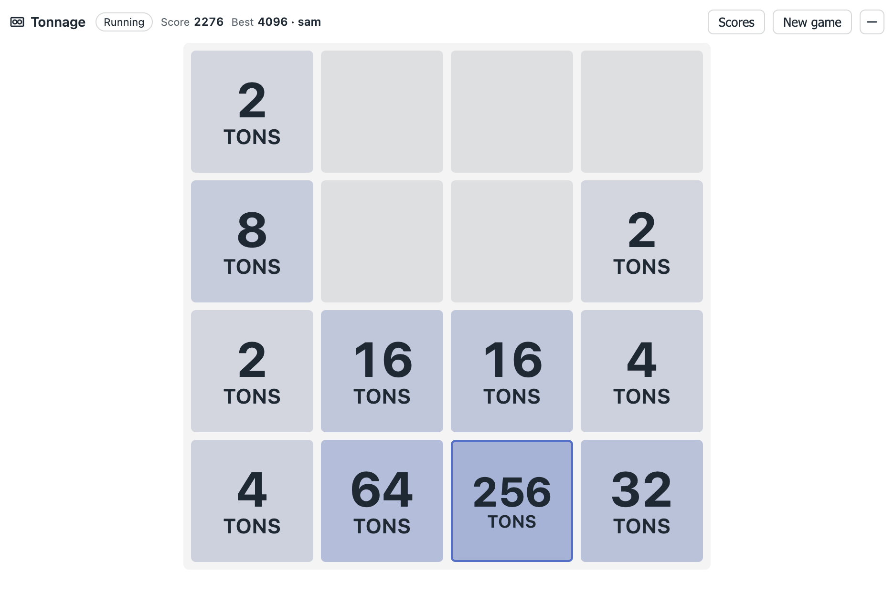
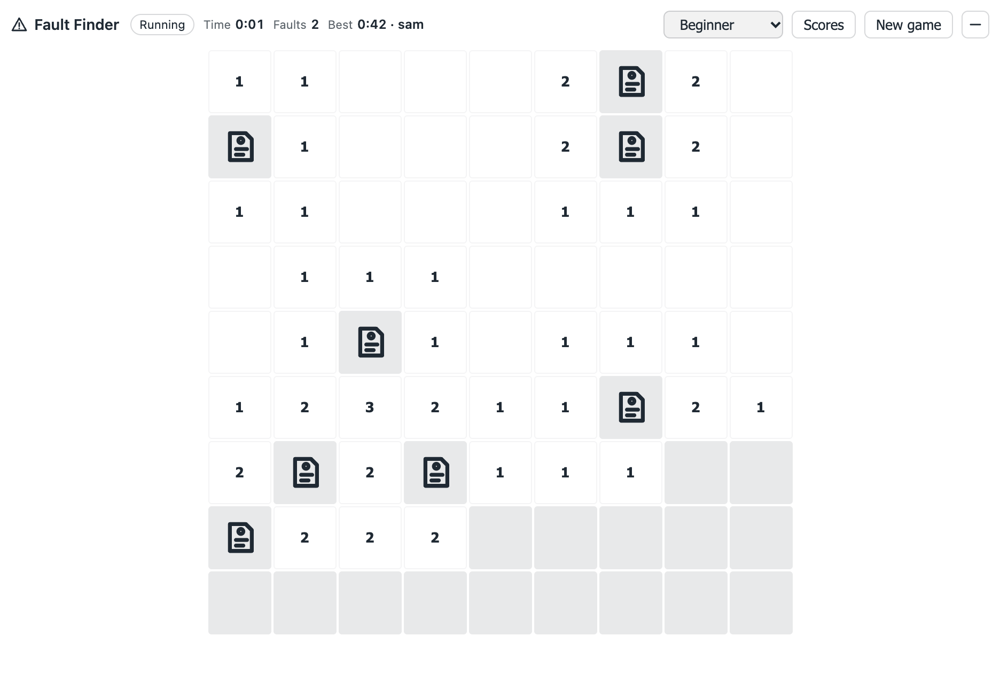
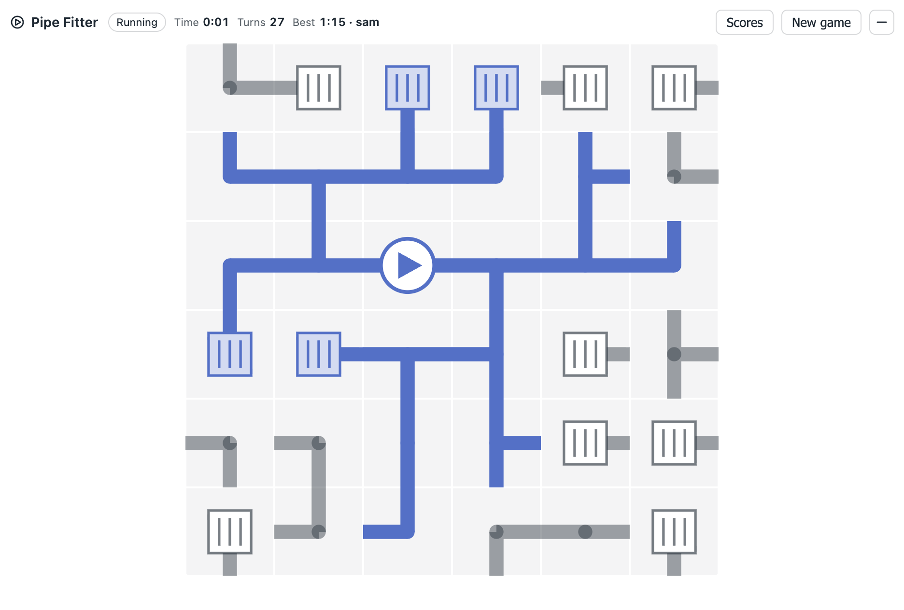
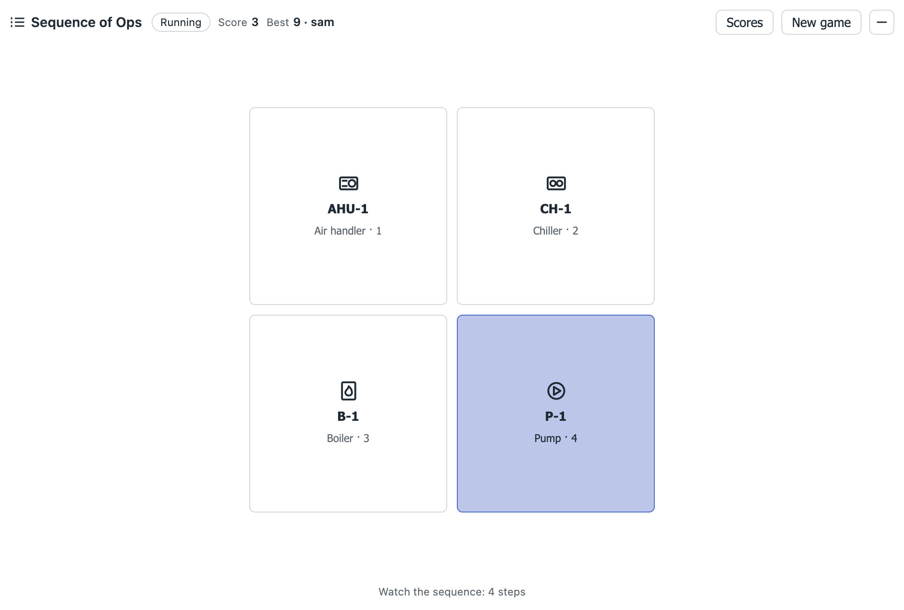
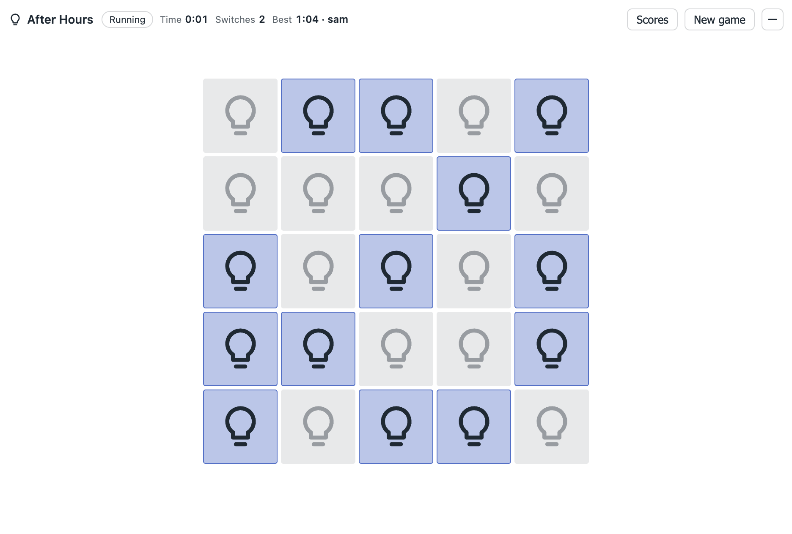

# lookBusy

Small building-automation themed games for Niagara 4 Px pages and station views. They don't read station data. The only thing they write is scores, to a `LookBusy` component.



| | |
| --- | --- |
|  Duct Run |  Damper Dash |
|  Panel Build |  Tonnage |
|  Fault Finder |  Pipe Fitter |
|  Sequence of Ops |  After Hours |

| Game | Widget type | Plays like | Scoreboard |
| --- | --- | --- | --- |
| Duct Run | `SnakeWidget` | Snake: run duct to ceiling diffusers on a ceiling grid | diffusers, highest first |
| Damper Dash | `DamperDashWidget` | Flappy Bird: push a puff of supply air through the open dampers | sections, highest first |
| Panel Build | `PanelBuildWidget` | Tetris: drop I/O modules onto DIN rails; a full rail clears | points, highest first |
| Tonnage | `Game2048Widget` | 2048: merge chillers up to a 2048-ton plant | points, highest first |
| Fault Finder | `MinesweeperWidget` | Minesweeper: faults and lockout tags | time, Beginner and Intermediate boards |
| Pipe Fitter | `PipeFitterWidget` | Rotate fittings until every coil is on the pump loop | time |
| Sequence of Ops | `SequenceWidget` | Simon: repeat the AHU / chiller / boiler / pump start-up order | steps, highest first |
| After Hours | `AfterHoursWidget` | Lights Out: switch every lighting zone off | time |

The type names `SnakeWidget`, `Game2048Widget` and `MinesweeperWidget` were kept from the first build, so Px widgets already placed with them keep working. The lexicon gives them their game names.

## What's in the palette

`lookBusy` palette (one palette, in `lookBusy-rt`):

| Entry | What it is |
| --- | --- |
| `LookBusy` | Station component that holds the scoreboards. Its **Look Busy** view (an agent on the type) is the game menu. |
| `PxWidgets/LookBusyMenu` | Menu of all eight games with each game's best score and a Scores button (`view:lookBusy:LookBusyView`). |
| `PxWidgets/DuctRun`, `DamperDash`, `PanelBuild`, `Tonnage`, `FaultFinder`, `PipeFitter`, `SequenceOfOps`, `AfterHours` | A single game per widget. |

Every widget has the same properties:

- `lookBusyOrd` (`baja:Ord`): the LookBusy component that holds the scoreboards. If it's empty and the widget isn't bound to a LookBusy, scoreboards stay in that browser's local storage and a note under the board says so.
- `startCollapsed` (`baja:Boolean`, default false): the widget starts hidden.
- `backgroundColor`, `textColor`, `accentColor` (`gx:Color`). All text uses Text Color, and secondary text, lines and cells are tints of it. The accent colors the duct, air puff, modules, tiles, water and lit equipment, never text. The status pill uses Niagara's lexicon status colors (`Status.overridden.*` for Paused, `Status.alarm.*` for Game over), so station lexicon overrides carry over.

## Hiding the widget

The `—` button in the header, or **Esc** while the widget has focus, hides it. A hidden widget turns see-through except for a small button in its top-right corner, which brings it back. Hiding also pauses the game:

- Duct Run, Damper Dash and Panel Build pause.
- Timed games stop their clock.
- Sequence of Ops replays the current sequence from the top when it comes back.

Opening the scoreboard pauses the game the same way.

The Px layout box doesn't shrink. The widget's area becomes transparent and ignores clicks. Whether clicks reach Px widgets underneath depends on how the Px page nests its WebWidget elements; check it on a real page.

## Scoreboards

`LookBusy` has one read-only property per board: `ductRunScores`, `damperDashScores`, `panelBuildScores`, `tonnageScores`, `faultsBeginnerScores`, `faultsIntermediateScores`, `pipeFitterScores`, `sequenceScores`, `afterHoursScores`. Each holds the top ten runs, best first, as readable text, for example `31 ben 2026-10-15 | 18 sam 2026-10-14`. Times are in seconds.

Widgets add a run through the hidden action `submitScore` (argument `board:value`), which has the operator flag and no audit entry. The component does the merge, one submission at a time, and records the user name from the session. Ties keep the earlier run ahead. The action returns the rank, which the widget shows ("Placed #3 on the scoreboard"). `Reset Scores` is an admin action with a confirm prompt. If the station rejects a submit (for example, missing permission), the note under the board shows the error.

## Controls

- Duct Run: arrow keys / WASD or swipe. Space pauses, and restarts after game over. The run pauses when the widget loses focus.
- Damper Dash: Space, Up or click/tap pushes the air. P pauses. Space restarts after a crash.
- Panel Build: Left/Right move, Up or X rotates (Z rotates back), Down soft-drops, Space drops. P pauses, Enter restarts after game over. On touch: tap rotates, swipe left/right moves, swipe down drops. The first key only starts the game. Points are 100/300/500/800 times the level for 1–4 rails, plus 1 per soft-dropped row and 2 per hard-dropped row. The level rises every ten rails.
- Tonnage: arrow keys / WASD or swipe.
- Fault Finder: click to check a square. Right-click or long-press tags a fault. Clicking a number whose tags are all placed opens its neighbors. The first click is always safe.
- Pipe Fitter: click turns a fitting clockwise, right-click turns it counter-clockwise. Arrow keys move a cursor; Space or Enter turns (with Shift, counter-clockwise).
- Sequence of Ops: click the equipment or press 1–4. Space starts.
- After Hours: click a zone. Arrow keys move between zones; Space or Enter switches.

Click the widget first so it has keyboard focus.

## Build (user-run)

Put this folder in a Niagara 4 Gradle parent workspace whose settings discover module projects (the `com.tridium.settings.multi-project` plugin with `findProjects()`, as the Niagara New Module wizard sets up). From that workspace:

```
gradlew.bat :lookBusy-rt:jar :lookBusy-ux:jar
```

Expected output: `lookBusy-rt.jar` and `lookBusy-ux.jar` under each part's `build/libs/`. Every B-class is `@NoSlotomatic` with hand-written slots, so no Slot-o-Matic step is needed. Install both jars in the station's and Workbench's `modules` folders, then restart the station and Workbench.

Adding Damper Dash and Panel Build only added properties to `LookBusy`, so a component saved with the six-game build loads as-is, with empty boards for the new games.

The `LookBusy` component's properties changed from the first build: the per-game `...Best`/`...BestBy` properties were replaced by the scoreboards. If a LookBusy component from that build is saved in a station, delete it before installing; the old scores aren't carried over. Px widgets from the first build don't need changes.

The preferred symbol is `lbusy`. `lb` is already taken by the installed `lonBelimo-rt`.

### Niagara version

The manifest works the same way as QAGcharts': `bajaVersion` 4.10, vendor `qag`, and the Niagara dependency versions are stripped from the generated `module.xml` (`writeModuleXml` post-step in both part Gradle files). The jars built against 4.15 therefore don't require 4.15. The ux part's `lookBusy-rt` dependency is rewritten to vendor `qag` to match.

What that rests on, checked against the 4.13.2.18 SDK (the oldest installed here):
- The bajaux `{ params, defaults }` constructor processing is marked `@since Niagara 4.10`.
- `BIJavaScript`, `JsInfo.make(BOrd)`, `BIFormFactorMax`, `Flags.OPERATOR/HIDDEN/NO_AUDIT/CONFIRM_REQUIRED` and `lex!baja` are all present.
- `@NoSlotomatic` has `SOURCE` retention, so it isn't needed at runtime.
- The Java uses Java 8 APIs only (`java.time.LocalDate`).

4.10–4.12 couldn't be checked locally because those SDKs aren't installed. Install and test on the oldest station you care about.

Older Workbench builds have an older built-in browser. The CSS avoids `inset` for that reason. Flex `gap` and the tile pop animation fall back to tighter spacing and no animation on very old engines.

Earlier builds used the root default vendor `QAGraphics`. Replace both jars together so the ux part's dependency on `lookBusy-rt` matches.

## Station test

1. Drag `LookBusy` into the station and open its **Look Busy** view. Note whether it opens by default on double-click; that hasn't been checked. The menu should list six games with "—" for every best.
2. Play Tonnage to game over. The status line should say "New best on the scoreboard!", the menu should show your score and user name, and `tonnageScores` should hold one entry.
3. Log in as a second operator in another browser and finish a run. The first browser's menu and scoreboard should update without a reload, and the rank in the status line should match the board.
4. On a Px page, drop `PxWidgets/DuctRun` and set `lookBusyOrd` to the LookBusy. Best should match, and the note under the board should disappear.
5. Press Esc. The widget should shrink to the corner button and Duct Run should pause. Check whether Px widgets underneath can be clicked, then restore the widget.
6. Set `startCollapsed` on a widget, save the Px and reopen it. The widget should start hidden.
7. As an operator, submit a score and confirm `Reset Scores` is admin-only.

## Harness (not packaged)

`tests/harness/` runs the real widget code against mocked bajaux, BajaScript and `lex!baja`. The mock `submitScore` mirrors `BLookBusy`'s merge. Serve this folder (for example `python3 -m http.server 8767`) and open `/tests/harness/index.html`.

The toolbar switches view, binding mode (agent view, unbound with `lookBusyOrd`, saved Px value, nothing set, bad or missing ORD), theme, instance count and `startCollapsed`. "Remote record" writes runs as another user. `audit.js` provides `qaAudit()` (contrast of every visible text against what's actually behind it) and `qaSources(probe)` (text that ignores Text Color; alarm and overridden pills are exempt). A harness pass doesn't replace the station test.

## SDK evidence (N4.15.1.16)

- Widget properties are declared through `defaults` in the constructor: `bajaux-ux.jar` `rc/Widget.js`.
- Actions returning a value with `Flags.HIDDEN | Flags.NO_AUDIT`: `docSource-doc.jar` `baja/javax/baja/job/BJob.java` (`readLogFrom`, `readLog`/`doReadLog`).
- `Component.invoke({ slot, value })` resolves with the action's return value: `bajaScript-ux.jar` `rc/baja/comp/Component.js`.
- Status colors: `baja.jar` `baja.lexicon` `Status.alarm.bg/fg`, `Status.overridden.bg/fg`, read through `lex!baja` as in QAGSite's `siteCore.js`.
- The palette `WebWidget` XML is copied from `webChart-ux.jar` `module.palette`.
- Lexicon keys: `Type.displayName` per `docDeveloper-doc.jar` `doc/workbench.html`; bare slot-name keys per `alarm-rt.lexicon`.
- `newProperty`, `newAction(int, BValue, BFacets)`, `invoke(Action, BValue, Context)`, `Context.getUser()`, `BUser.getUsername()`, `BString.make/getString` and the flags were checked with `javap` against `baja.jar`. None of the new method names exist in the `BComponent` superclass chain.
- The `preferredSymbol` was checked against the `META-INF/module.xml` of every installed module.

## License

MIT. See [LICENSE](LICENSE).
